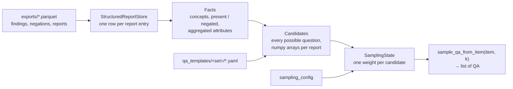

# Q/A generation (`rsx.qa`)

Turns the structured reports exported by `rsx export` into question/answer pairs for training a
decision model on three question types:

| Type | Answer | Example |
|---|---|---|
| **Noul** | Yes / No | *Is there any pleural effusion on the left side?* → `Yes` |
| **Choice** | one of several options (shuffled) | *In which lobe is the lung nodule located?* → `right lower lobe` |
| **Score** | one of several **ordered** options | *How severe is the emphysema?* → `minimal < [mild] < moderate or severe` |

Everything that is expensive (reading, aggregating, building every possible question, computing
the weights) happens once, when the generator connects to an export folder. Drawing the questions
of one image is then a slice of numpy arrays plus string formatting (~150 µs for 8 questions).



```python
from rsx.qa import CTRATEGenerator

gen = CTRATEGenerator("chest_ct_findings")
gen.connect_structured_report("runs/chest_ct_findings/gpt-oss-120b/ctrate_train_v31/exports")
for qa in gen.sample_qa_from_item("train_10001_a_1.nii.gz", 8, rng=0):
    print(qa.question, qa.options, qa.answer_text)
```

## Contents

1. [Quick start](quickstart.md): load, sample, inspect from the command line
2. [Question types and answers](question_types.md): where Yes / No / options come from, what is skipped
3. [Templates](templates.md): the YAML files, `where` filters, builders, dataset overlays
4. [Sampling configuration](sampling.md): question-type shares, rare findings, answer balance,
   quality flags, item weights, shortcut check
5. [Held-out phrasings](phrasings_holdout.md): measuring generalization to unseen wordings
6. [PyTorch dataset](pytorch_dataset.md): a complete `Dataset` + `DataLoader` example
7. [Adding a dataset](new_dataset.md): a generator subclass per dataset

> [!CAUTION]
> Entries with quality alerts (`location_alert`, `lat_lobe_conflict`, ...) **are sampled by
> default**. To leave them out, give them a weight of 0 in `sampling_config.flag_weights`:
> see [Quality flags](sampling.md#quality-flags).

## Files

| Path | What |
|---|---|
| [`src/rsx/qa/store.py`](../../src/rsx/qa/store.py) | reads an export folder (parquet, CSV fallback) |
| [`src/rsx/qa/facts.py`](../../src/rsx/qa/facts.py) | concepts, present / negated state, aggregated attributes, quality flags |
| [`src/rsx/qa/templates.py`](../../src/rsx/qa/templates.py) | YAML loading, `where` filters, phrasing splits, overlays |
| [`src/rsx/qa/builders.py`](../../src/rsx/qa/builders.py) | one function per kind of question |
| [`src/rsx/qa/generator.py`](../../src/rsx/qa/generator.py) | `QAGenerator`: compile, sample, `item_weights`, `freeze` |
| [`src/rsx/qa/sampling.py`](../../src/rsx/qa/sampling.py) | `SamplingConfig` and the weights |
| [`src/rsx/qa/diagnostics.py`](../../src/rsx/qa/diagnostics.py) | `blind_baseline`: shortcut check |
| [`src/rsx/qa/datasets/ct_rate.py`](../../src/rsx/qa/datasets/ct_rate.py) | `CTRATEGenerator` |
| [`qa_templates/chest_ct_findings/`](../../qa_templates/chest_ct_findings) | concepts, templates, default sampling, CT-RATE overlay |

The package does not import torch: the `Dataset` lives in the training code
([example](pytorch_dataset.md)).

These pages are meant to be read on GitHub (they use GitHub alerts and a mermaid diagram).
